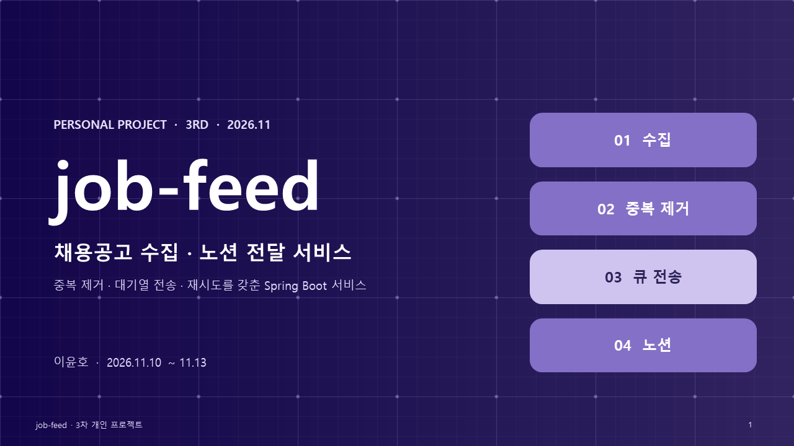
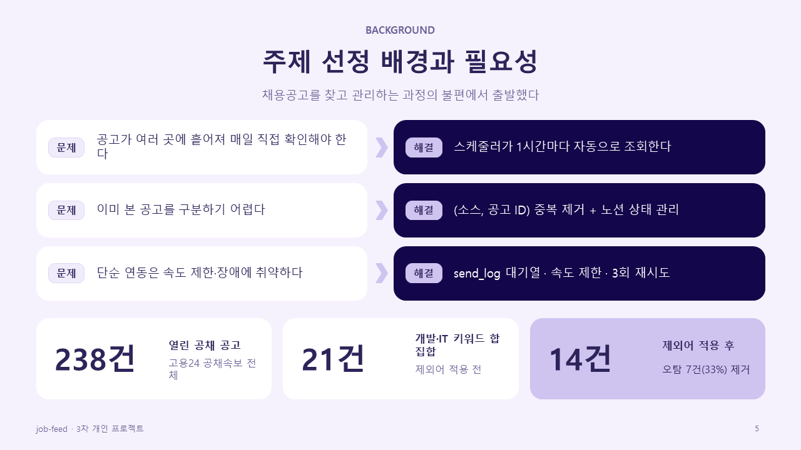
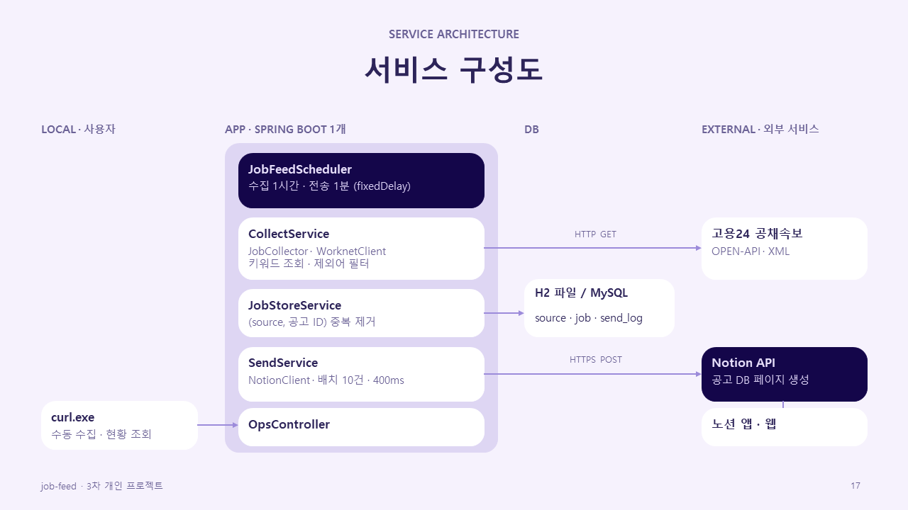
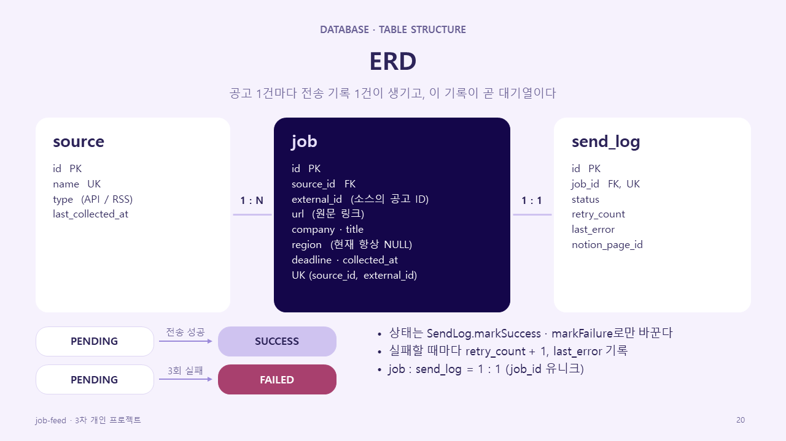
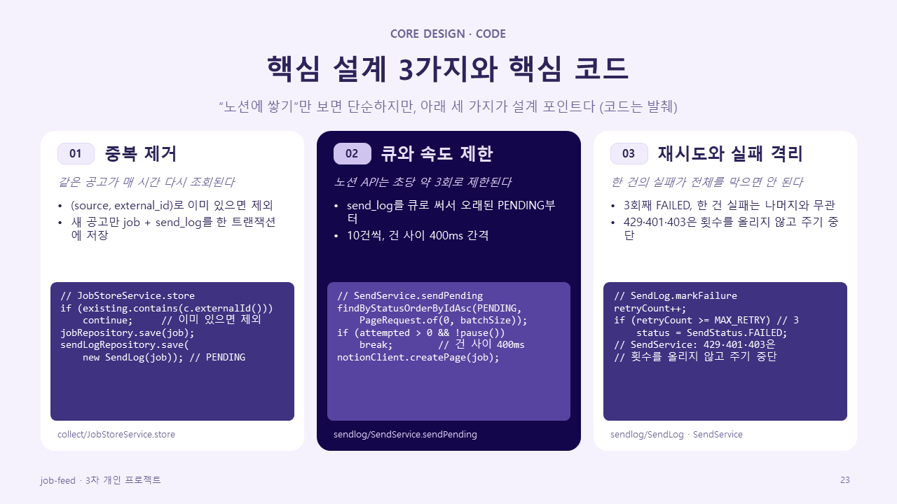
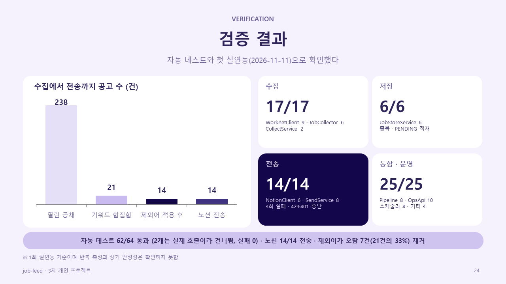

# job-feed 문서



[job-feed](https://github.com/ho8566z/job-feed) 프로젝트의 명세서와 발표 자료를 모아 둔 문서 저장소입니다. (3차 개인 프로젝트, 2026.11.10 ~ 11.13)

코드는 [job-feed](https://github.com/ho8566z/job-feed) 저장소에 있고, 이 저장소에는 구현 전에 정한 기획·설계 문서와 발표 자료만 둡니다.

## 프로젝트 요약

고용24 공채속보의 채용공고를 주기적으로 수집해 (소스, 공고 ID) 기준으로 중복을 거른 뒤, 속도 제한에 맞춰 노션 DB로 전달하는 Spring Boot 서비스입니다.



- **해결하려는 문제**: 채용공고가 여러 곳에 흩어져 매일 직접 찾아야 하고, 이미 본 공고를 구분하기 어렵다. 단순 연동은 외부 API의 속도 제한·장애에 취약하다.
- **핵심 기능**: 수집 스케줄러, 중복 제거, send_log 대기열 전송, 재시도·실패 격리, 노션 상태 보드·마감일순 뷰
- **기술 스택**: Java 17, Spring Boot, Spring Data JPA, H2·MySQL, 고용24 OPEN-API, Notion API, JUnit
- **작업 방식**: 기획·설계·구현·테스트·문서를 혼자 진행

## 폴더 구성

```
images/
  ppt/                             README에 넣은 발표 자료 슬라이드
excel_output/
  3차_개인프로젝트_job-feed_명세서.xlsx   명세서 전체(시트 14개)
docs/
  job-feed_ERD_흐름도.md            ERD와 흐름도
  job-feed_다이어그램.md            클래스·워크플로우 다이어그램
ppt_output/
  job-feed_3차_개인프로젝트_29장_라벤더_격자.pptx   발표 자료(29장)
  job-feed_ppt.pdf                 발표 자료 PDF
  job-feed_3차_개인프로젝트_29장_라벤더_격자/       슬라이드 이미지(슬라이드1~29.PNG)
```

## 명세서 (excel_output/3차_개인프로젝트_job-feed_명세서.xlsx)

| 시트 | 내용 |
| --- | --- |
| 프로젝트 개요 | 목표, 서비스 구성, 기술 스택, 실행 흐름, 구현 상태 |
| WBS | 4일 일정(기획·설계 → 구현 → 검증 → 문서)과 작업별 상태 |
| 요구 명세서 | 구분별 요구사항(ID, 우선순위, 수용 기준) |
| 기능 목록 | 기능 ID, 설명, 구현 위치 |
| 기능 명세서 | 입력, 처리 순서, 업무 규칙, 예외 |
| API 명세서 | 외부(고용24, Notion)와 내부(`/api/v1/collect`, `/api/v1/send-logs`) API |
| 테이블 명세서 | `source`, `job`, `send_log` 테이블과 컬럼 |
| 설정·규약 | 환경변수, 프로필, 주기·배치 크기 등 공통 기준 |
| 2순위 기능 | 핵심 기능 이후로 미룬 기능 |
| 트러블슈팅 | 개발 중 만난 문제와 해결 |
| 산출물 체크리스트 | 제출 산출물 항목과 작성 상태 |
| 테스트 결과 | 자동 테스트와 실연동 결과 |
| 달성도·개선 | 목표 달성도, 아쉬운 점, 개선 계획 |
| 유사 서비스 비교 | 비교 대상과 차별점 |

## 시스템 구성



스케줄러가 1시간마다 수집하고 1분마다 대기열(`send_log`)의 PENDING을 노션으로 보냅니다. 외부 서비스는 고용24 공채속보 API와 Notion API 두 개입니다.

## 데이터 모델



공고 1건마다 전송 기록 1건이 생기고, 이 기록이 곧 전송 대기열입니다. 컬럼과 관계는 명세서의 `테이블 명세서` 시트와 `docs/job-feed_ERD_흐름도.md`에 있습니다.

## 핵심 설계



- **중복 제거**: (source, external_id)로 이미 저장한 공고를 거르고 새 공고만 한 트랜잭션에 저장
- **큐와 속도 제한**: PENDING을 오래된 순으로 배치 크기만큼, 건 사이 간격을 두고 전송
- **재시도와 실패 격리**: 3회째 FAILED, 한 건의 실패가 나머지를 막지 않음. 429·401·403은 횟수를 올리지 않고 그 실행을 멈춤

## 검증과 한계



- 자동 테스트 64개 중 62개 통과, 2개는 실제 호출이라 환경변수가 없으면 건너뜀, 실패 0개
- 실연동(2026-11-11, 1회): 열린 공채 238건 → 키워드·제외어 후 14건 → 노션 14/14 전송
- 소스가 공채속보 하나라 지역 정보가 없고 개발 직군 공고가 적습니다. 반복 측정과 장기 안정성, MySQL 프로필 실행, 고용24 호출 한도는 확인하지 못했습니다.

## 발표 자료

전체 발표 자료(29장)는 `ppt_output/job-feed_3차_개인프로젝트_29장_라벤더_격자.pptx`와 `ppt_output/job-feed_ppt.pdf`에 있습니다. 이 README에는 설명에 필요한 슬라이드만 해당 섹션에 넣었습니다.

## 작성자

이윤호 (개인 프로젝트)
