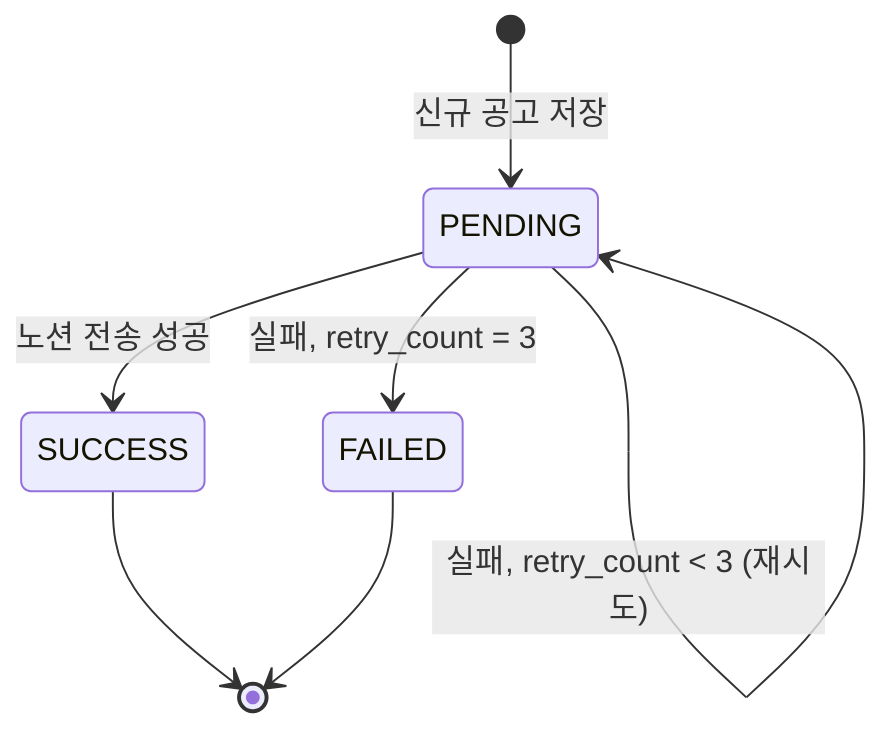
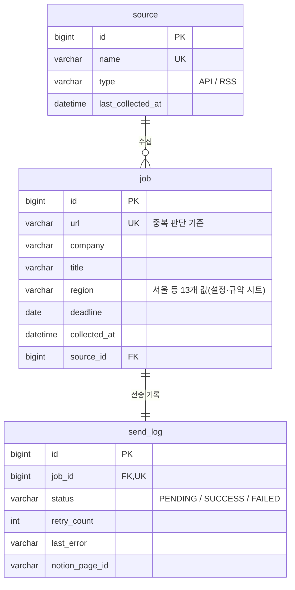

# job-feed ERD · 흐름도

> 3차 개인 프로젝트 (2026.11.10 ~ 11.13). 명세의 기준은 `excel_output/3차_개인프로젝트_job-feed_명세서.xlsx`이고, 이 파일은 그림용이다.
> 외부 API(워크넷)의 실제 응답 필드·한도는 인증키 발급 후 확정한다(확인 전).

## 1. 서비스 구성 · 데이터 흐름

```mermaid
flowchart LR
    S1[수집 스케줄러<br/>@Scheduled] --> C[수집<br/>@Async 병렬]
    C -->|공고 목록 조회| W[(워크넷<br/>채용정보 API)]
    C --> N[정규화<br/>회사·직무·지역·마감일·URL]
    N --> D{URL이 이미<br/>job에 있나?}
    D -- 있음 --> X[제외]
    D -- 없음 --> J[(job 저장)]
    J --> Q[(send_log<br/>PENDING)]
    S2[전송 스케줄러] -->|PENDING 몇 건씩<br/>초당 3건 이하| Q
    S2 --> P[Notion API<br/>페이지 생성]
    P -->|성공| OK[send_log SUCCESS<br/>notion_page_id 저장]
    P -->|실패| R{retry_count<br/>3회?}
    R -- 아니오 --> Q
    R -- 예 --> F[send_log FAILED]
    P --> V[노션 공고 DB]
    V --> M[채용공고 대시보드<br/>지역별 링크드 뷰]
```

## 2. 전송 상태 전이 (send_log.status)



## 3. ERD


