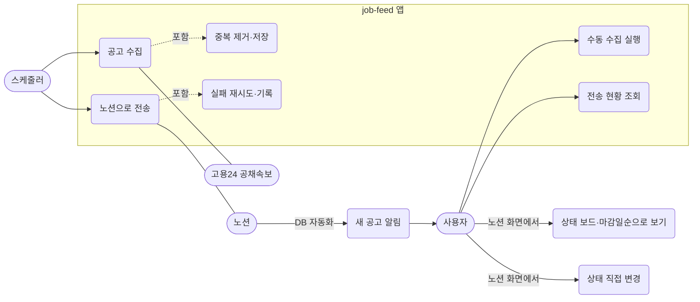
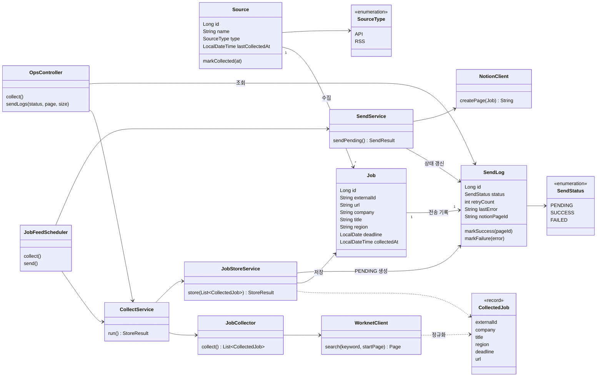

# job-feed 다이어그램 · 핵심 코드 위치

> 2026-11-11 기준 구현(`job-feed` 레포 dev + feature/h2-file-profile)에서 정리했다. 다이어그램은 Mermaid라 GitHub와 노션(코드 블록 > Mermaid)에서 그림으로 보인다.
> 구성도와 ERD는 `job-feed_ERD_흐름도.md`에 있다.

## 1. 유스케이스

액터는 사용자(노션 소유자), 스케줄러, 외부 서비스(고용24, 노션)이다. 로그인·회원 기능은 없다.

노션 화면에서 하는 일(보기, 상태 변경, 알림)은 앱 코드가 아니라 노션 설정이다. 내부 API(수동 수집, 전송 현황)는 `127.0.0.1`에서만 열린다.

## 2. 클래스 다이어그램

설정 클래스(`WorknetProperties`, `SendProperties`, `NotionProperties`), 예외(`WorknetApiException`, `NotionApiException`, `CollectInProgressException`), 리포지토리와 `Kst`(한국 시간)는 생략했다.

## 3. 핵심 코드 위치

비동기 수집은 소스가 1개라 만들지 않았다. 핵심은 아래 세 가지다.

| 핵심 | 하는 일 | 위치 |
|---|---|---|
| **중복 제거** | `(source, external_id)`로 이미 저장한 공고를 걸러내고, 새 공고만 `job`과 `send_log(PENDING)`로 한 트랜잭션에 저장 | `collect/JobStoreService.store`, `job/Job`의 복합 유니크 |
| **큐와 속도 제한** | `send_log`를 큐로 써서 PENDING을 오래된 순으로 배치 크기만큼 꺼내고, 건 사이 간격(기본 400ms)을 둠 | `sendlog/SendService.sendPending`, `sendlog/SendProperties` |
| **재시도와 실패 격리** | 실패하면 횟수를 올려 3회째 FAILED, 한 건의 실패가 나머지 전송을 막지 않음. 429·401·403은 횟수를 올리지 않고 그 주기를 멈춤 | `sendlog/SendLog.markFailure`, `sendlog/SendService` |

그 밖의 코드는 다음 위치에 있다.

| 기능 | 위치 |
|---|---|
| 고용24 호출·XML 해석·정규화 | `collect/WorknetClient` |
| 키워드별 조회, 합집합, 제외어 필터 | `collect/JobCollector` |
| 수집 동시 실행 방지(스케줄러와 수동 호출) | `collect/CollectService` |
| 노션 페이지 생성과 속성 매핑 | `notion/NotionClient.buildBody` |
| 내부 API | `api/OpsController`, `api/ApiExceptionHandler` |
| 스케줄 | `schedule/JobFeedScheduler` |
